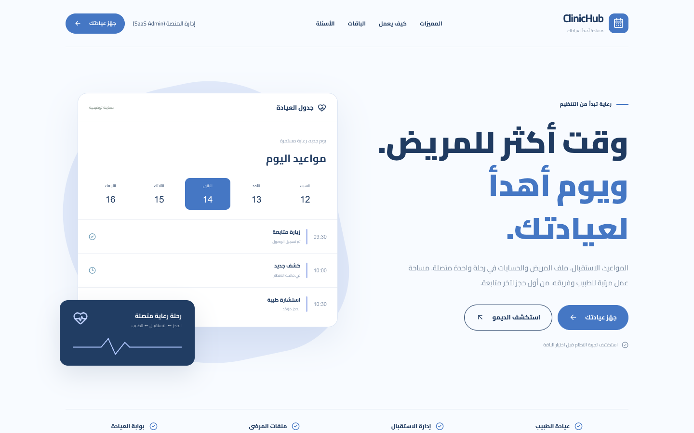
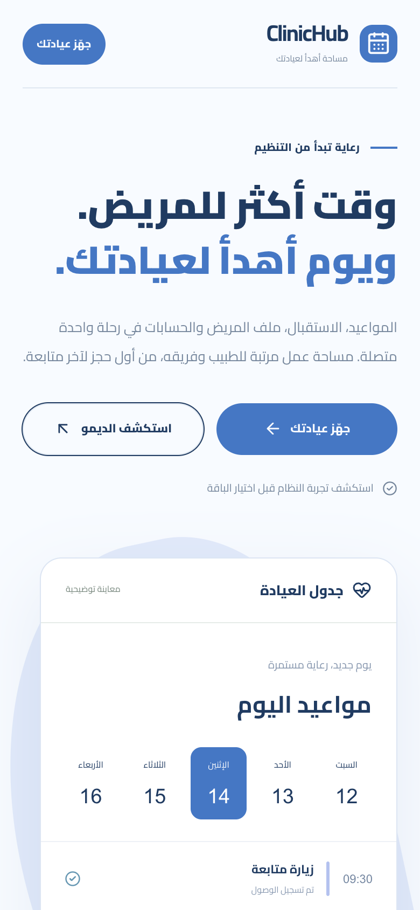
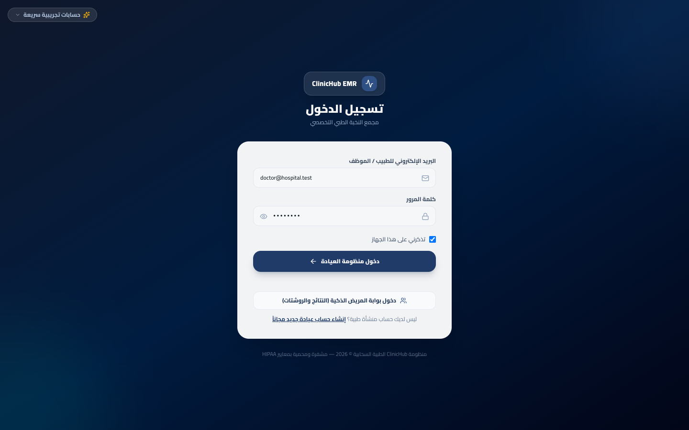
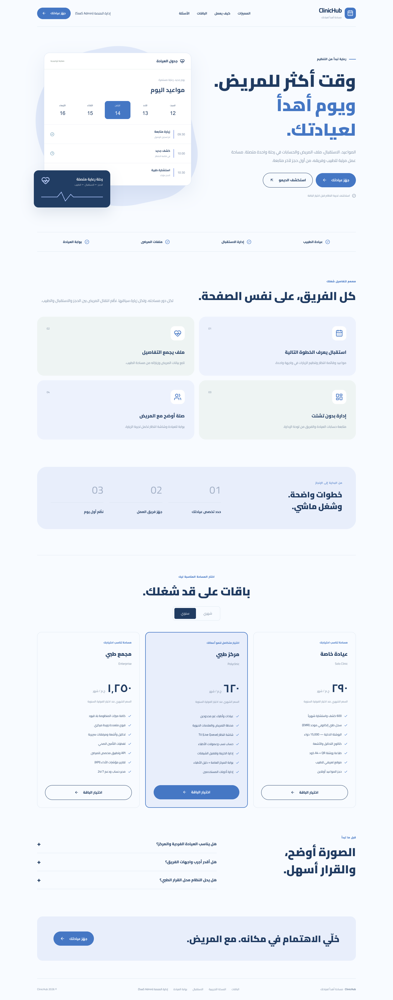

# ClinicHub (كلينك هَب)

> Cloud platform for clinics and medical centers, with e-prescriptions.

**Live:** [clinichub.virvib.com](https://clinichub.virvib.com/) · **Role:** Founder & developer · **Period:** 2026 · **For:** Own product

    

## Overview

A multi-tenant SaaS for private clinics and specialty centers: patient records, appointments, prescriptions, billing and a patient portal.

## What it does

- Doctor EMR with ICD-10 diagnoses, history, allergies and chronic diseases
- Specialty clinical records and templates
- Electronic prescriptions
- Clinical AI assistant with a 15,000-drug knowledge base
- Patient portal with one-time-code login (SMS / WhatsApp)
- Waiting-room TV queue display

## Engineering highlights

- Database per clinic, with per-clinic backups, verify and restore
- Clinical RBAC, private attachments, financial isolation
- Concurrency locks on financial operations
- Monitoring: health reports, slow query and queue alerts, Sentry with patient-data scrubbing

## Screenshots (live site)

  
  

Full home page

---

Source code is private (client / commercial project). This repository documents the work only.

Built by **Ahmed Gamal** — Senior Laravel Developer · [LinkedIn](https://www.linkedin.com/in/wzcoder/) · [GitHub](https://github.com/ahmed-gamal-dev)
